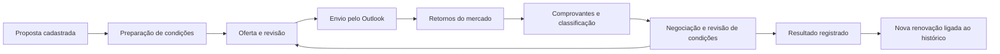

# Oferta Re: portal de propostas e renovações

Data: 08/10/2026. Direção solicitada pelo autor: ampliar o SaaS para envio e controle de propostas/renovações. Escopo mantido em **resseguro**, para corretoras e seus setores Treaty/facultativos. Estado: posicionamento, cadastro/carteira, acompanhamento, renovação vinculada, novas versões e exigência de comprovantes implementados. Integração Microsoft 365 ainda planejada.

## Posicionamento e valor

Oferta Re organiza a operação da corretora do cadastro do negócio ao retorno do mercado, com histórico para a próxima renovação. A consulta SUSEP passa a ser apoio à seleção do mercado. O valor comercial principal vem do processo da empresa: carteira compartilhada, preparo de ofertas, prazos, histórico e recuperação dos comprovantes. Não depende de restringir consultas públicas disponíveis gratuitamente.

Dores relatadas pelo autor: planilhas para organizar contatos, copiar textos antigos, selecionar mercados em macro Outlook, procurar canais de contato, guardar respostas em pastas e reconstruir o processo na auditoria. O portal reúne esses pontos gradualmente. Essa redução de trabalho é hipótese de valor; o tempo economizado ainda precisa ser medido no piloto.

Hipótese de contratação: assinatura por empresa com usuários/setores e faixas de uso operacional, potencial implantação/importação autorizada e futura personalização de marca. Nenhum preço, checkout, franquia ou cobrança foi ativado. Medir uso por propostas, versões/envios e armazenamento antes de escolher limites; volume de consultas ao catálogo não representa sozinho esse valor.

## Conceitos

| Conceito | Papel no portal |
| --- | --- |
| Empresa | Tenant e ambiente compartilhado, com logins individuais e papéis |
| Setor | Time responsável, sem isolamento entre setores da mesma empresa |
| Linha de negócio | Classificação interna cadastrada pela empresa |
| Proposta | Processo de um novo negócio ou renovação, independente de já existir e-mail |
| Oferta ao mercado | Comunicação de condições para análise pelos mercados; pode ter várias versões |
| Destinatário/versão | Contato e resseguradora preservados no momento do preparo, com envio e respostas próprios |
| Resposta | Retorno do mercado com classificação e comprovante, sem concluir automaticamente o processo |
| Renovação | Novo processo ligado ao anterior; não sobrescreve ou herda seus envios/aceites |
| Colocação/encerramento | Resultado registrado pela equipe, com motivo; não é inferência jurídica automática |

A referência de contrato pode existir antes da contratação final. Dados de risco, cedente e vigência não equivalem a contrato celebrado. O e-mail preparado não equivale à mensagem efetivamente enviada.

## Fluxo

O ciclo de negociação pode gerar outra versão da oferta. Nesta entrega, envio é manual no Outlook e seu registro é informado pela equipe. Captura automática de envios/respostas depende da integração Microsoft 365 descrita em [Rastreio Outlook](rastreio-outlook-e-respostas.md).

## Interface entregue

- `/`: apresentação do portal e acesso ao ambiente/demo. Sem mascote decorativo no conteúdo; identidade azul/verde e lateral compacta preservadas.
- `/resseguradoras`: consulta pública, filtros e exportação existentes, agora como módulo de apoio.
- `/workspace`: visão geral por empresa com propostas/renovações ativas, prazos vencidos e vigências a vencer; acesso à carteira.
- `/workspace/propostas`: cadastro independente de contatos/modelos, lista e pipeline, filtros por título/referência/cedente/risco/contrato, tipo, etapa e setor. Indicadores consideram toda a carteira, enquanto filtros afetam os registros exibidos.
- `/workspace/propostas/[id]`: dados, vigência, prazo/pendência, histórico anterior, eventos, ofertas/versões, destinatários e respostas. Formulário de acompanhamento, preparo da primeira oferta/nova versão e ação “Iniciar renovação”.
- `/workspace/ofertas` e `/workspace/ofertas/[id]`: redirecionam às rotas novas, mantendo parâmetros e links antigos.
- `/demonstracao?tela=propostas`: carteira fictícia, filtros/pipeline e cadastro demonstrativo sem gravação. Cards abrem detalhe fictício com ligação ao processo anterior.
- Contatos, modelos, setores, equipe, comprovantes e notícias regulatórias permanecem disponíveis no ambiente.

Cadastro: tipo novo negócio/renovação, referência única, título, cedente, segurado/risco opcional, referência contratual opcional, setor, linha de negócio, processo anterior opcional, início/fim de vigência, prazo da próxima ação e descrição da pendência. Uma renovação pode começar sem histórico no portal, indicando a referência externa do contrato. Ao iniciar renovação a partir de uma proposta, reaproveitam-se dados identificadores; datas, referência nova, condições e destinatários exigem revisão/preenchimento no processo novo.

Etapas: Em preparação, Em revisão, No mercado, Em negociação, Colocada, Não colocada e Cancelada. Registros anteriormente encerrados ficam “Encerrada (legado)”; a migração não inventa colocação bem-sucedida. Encerrar exige motivo; reabrir continua registrado no histórico. Não há aprovação formal de gestor nesta entrega: a etapa Em revisão é acompanhamento operacional.

Prazos vencidos excluem processos encerrados e comparam o prazo com a data de Brasília. Renovações com prazo em 30 dias consideram propostas de renovação ainda abertas. Vigências a vencer consideram registros marcados Colocada cujo fim de vigência está nos próximos 30 dias, independentemente de já haver uma renovação em preparo. Não existem lembretes automáticos ativos.

## Persistência e integridade

Migração `20261009030000_proposal_portal.sql` aplicada ao Supabase `vssghglrtxqkfpsdfeik`. Histórico remoto: seis migrações; colunas de portal confirmadas e RLS de eventos ativada. Aplicação pelo SQL Editor autenticado existente, sem novas leituras da credencial macOS/MCP. Nenhuma fixture de proposta, contato ou resposta foi criada no projeto hospedado para esta verificação.

`operations` continua sendo a proposta no banco, preservando IDs, referências e ligações de documentos/ofertas. Foram adicionados tipo, etapa, risco, linha, proposta anterior, vigência, prazo, próxima ação, motivo e revisão. Linha e processo anterior usam FK composta por organização. Cadeias de renovação rejeitam autorreferência e ciclos; datas rejeitam fim anterior ao início.

RPC `save_proposal` usa sessão/papel e RLS, cria em preparação e atualiza com comparação de revisão. Alteração concorrente devolve conflito. `prepare_proposal_offer` cria ou acrescenta versão à oferta da proposta, em transação, com snapshots de destinatários e numeração serializada por lock do processo. Não permite alterar negócios encerrados ou usar uma oferta de outra proposta. Preparo inicial leva preparação a revisão; não registra envio nem muda automaticamente para No mercado.

`proposal_events` é privado por organização e somente leitura para clientes; triggers registram criação, alterações com snapshots antes/depois, preparo de oferta, envio informado e registro/correção de resposta. Usuários não podem editar/remover esses eventos diretamente. A auditoria geral e imutabilidade das versões permanecem.

### Regra de respostas

Novas respostas e correções exigem documento do tipo resposta, ligado ao destinatário correto, com objeto já existente no bucket privado. Criar metadados sem concluir upload não basta. Trigger com acesso restrito verifica objeto e papel do tenant; não expõe conteúdo de outras empresas. A classificação inicial/manual pode ser a confirmar, dúvida, negativa ou aceite parcial/total. Qualquer classificação não encerra a proposta automaticamente.

Registros legados sem arquivo são preservados e identificados como pendentes; não há preenchimento artificial de comprovante. Alterações de classificação recebem snapshots no histórico. Existência do objeto confirma o recebimento do arquivo pelo Storage; o hash fornecido no upload manual ainda não representa verificação independente do conteúdo/origem. O fluxo Graph futuro deverá calcular/verificar os bytes recuperados no servidor.

## Próximas entregas

1. Conectar Microsoft 365 individual por OAuth, registrar o enviado real e capturar respostas/EML, com correlação/revisão, paginação, retries e deduplicação. Sem ampliar o endpoint de ingestão pública SUSEP para dados privados.
2. Condições estruturadas por versão e por mercado: limites, retenção, participações, moeda e prêmio, conforme facultativo/Treaty e exemplos autorizados. Nesta entrega, condições ficam no texto/anexos; não há cálculo financeiro ou participação automática.
3. Responsável operacional por pessoa, tarefas/follow-ups e revisão/aprovação configurável. Hoje autoria e setor são registrados, sem distribuição formal de trabalho individual.
4. Quadro de mercados por resseguradora com respostas/pendências consolidadas e condições comparáveis. Hoje acompanhamento é por contato/destinatário/versão; não somar participação duplicada de contatos da mesma empresa.
5. Carteira/agenda de renovações com tarefas e alertas realmente entregues, contratos e resultado operacional exportável. Prazos/vigências já aparecem, mas não há scheduler de notificações.
6. Pacote de auditoria com originais/índice, política de retenção, backup/restauração, importação de base autorizada e experiência de implantação por cliente.
7. Piloto e planos comerciais com métricas de uso, contratação e cobrança; nenhum plano pago foi lançado nesta rodada.

## Critérios de aceite verificados

- Criar proposta sem contato, modelo ou e-mail, depois preparar oferta no mesmo processo.
- Gerar renovação vinculada sem copiar respostas/envios antigos e sem relações entre tenants.
- Preservar v1 ao criar v2, inclusive snapshots de destinatários, sem envio automático.
- Registrar acompanhamento/resultado com histórico e conflito de edição, rejeitando fechamento sem motivo e datas inválidas.
- Bloquear resposta sem arquivo recebido, mantendo classificação distinta da colocação.
- Viewer lê sua carteira/histórico e não grava; outra empresa/anon não lê eventos privados.
- Registros históricos encerrados não são transformados em colocação bem-sucedida.

Verificação: testes PostgreSQL/validação/calendário, TypeScript/build, demo navegável, rota privada carregada com a sessão existente em leitura e API de eventos anônima bloqueada. Gravação hospedada pelo formulário, ciclo OAuth/Outlook, upload/arquivamento ponta a ponta e homologação de produção continuam necessários. Sem deploy Vercel ou commit/push nesta rodada.

## Avaliação para o TCC

Pergunta atualizada: como um portal compartilhado de propostas e renovações reduz esforço de organização e melhora a recuperação do histórico de ofertas e respostas em uma corretora de resseguro?

Comparar rotina com planilhas/Outlook/pastas e portal usando cenários equivalentes e fictícios. Medir tempo de cadastro/preparo, recuperação de resposta por versão/mercado, criação de renovação com histórico, taxa de associação correta, pendências e retrabalho. Separar funções implementadas de automações simuladas. Não declarar economia ou redução de risco regulatório sem medição/evidência; não usar dados da empresa anterior. A consulta SUSEP permanece como origem técnica e módulo de apoio, sem ser a única contribuição do TCC.
